<picture>
  <source media="(prefers-color-scheme: dark)" srcset="assets/header-dark.svg">
  
</picture>

The organisation behind [brandtstack.com](https://brandtstack.com): websites and apps, and the services and CI they run on, built and run by [Adrian Brandt](https://github.com/adrianbrandt).

## <picture><source media="(prefers-color-scheme: dark)" srcset="assets/h-public-dark.svg"></picture>

**[workspace-ci](https://github.com/brandtstack/workspace-ci)** · Reusable GitHub Actions workflows and a Renovate preset. The repos here use them to verify, version, build and release.

## <picture><source media="(prefers-color-scheme: dark)" srcset="assets/h-private-dark.svg"></picture>

The rest is private. Live sites keep their source closed, and the internal services sit behind a login. What they do is written up on [brandtstack.com](https://brandtstack.com) and on [Adrian’s profile](https://github.com/adrianbrandt).

Questions or work: [kontakt@brandtstack.com](mailto:kontakt@brandtstack.com)
